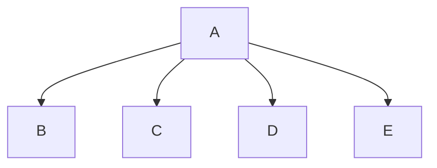

# Number Guessing Game
Jacob Duty, Aizen Cannon (The GOAT)

## Number Guessing Game Description
This program is a number guessing game, our first team project ever where Aizen demonstrates AWESOMENESS

### Number Guessing Game Chart

#### Function Diagrams

| `function name1`    |               |  author     |
| ------------------ | ------------- | ------------ |
| `argument:type`    | takes input from the user for ____  |              |
| `time:integer`     | calculates ______  | outputs ____             |
| `name:string`      | takes input for name ___ | returns total |
***
| `function name2`    |               |     author   |
| ------------------ | ------------- | ------------ |
| `argument:type`    | takes input from the user for ____  |              |
| `time:integer`     | calculates ______  | outputs ____             |
| `name:string`      | takes input for name ___ | returns total |
***